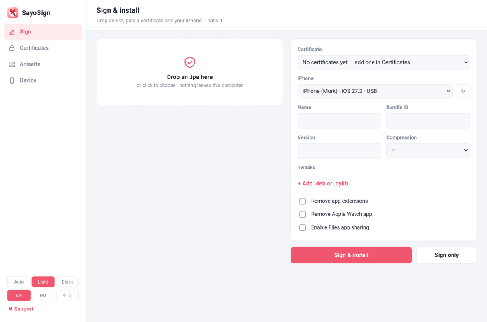
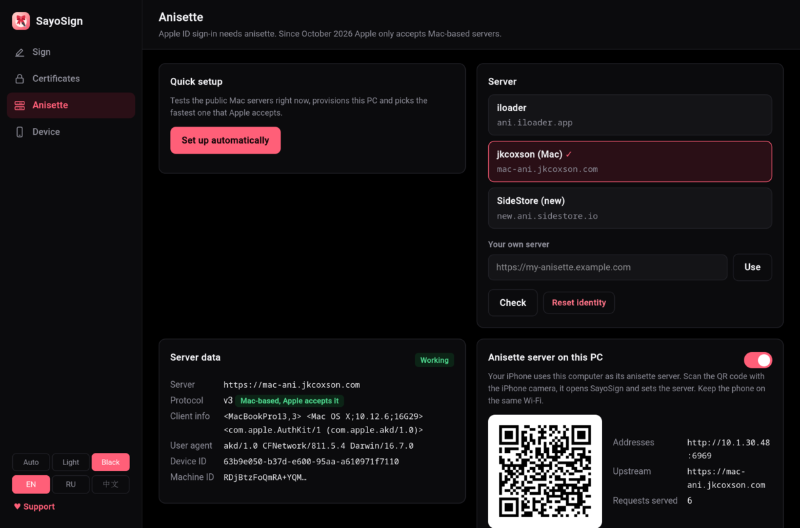

<p align="center"></p>
<h1 align="center">SayoSign Desktop</h1>
<p align="center">
  <b>Sign and install IPA files on your iPhone from Linux, Windows or macOS.</b><br>
  .p12 or Apple ID · tweak injection · working Apple ID sign-in in 2026 · anisette server on your PC
</p>
<p align="center">
  <a href="https://github.com/murk-sus/SayoSign-Desktop/releases/latest"><b>⬇ Download</b></a> ·
  <a href="README_RU.md">Русский</a> · <a href="README_ZH.md">简体中文</a> ·
  <a href="https://github.com/murk-sus/SayoSign">iOS app</a>
</p>
<p align="center">
  
  
</p>

## Features

- **Sign & install over USB** with a live progress bar, or sign only and download. Native window, no browser tab.
- **Certificates**: `.p12` + `.mobileprovision` with live Apple **OCSP** revocation check, or **sign in with a free or paid Apple ID** — the certificate, your iPhone's registration and a profile for every app are created automatically.
- **Tweaks**: inject `.deb` and `.dylib` (Substrate, ElleKit and libhooker tweaks are rewired to the built-in SayoHook).
- **App options**: name, bundle ID, version, remove extensions and Watch apps, Files sharing, compression.
- **Anisette tab**: quick setup, your own server, live server data, and an **anisette server on this PC** for your iPhone (scan the QR code).
- **Device**: installed apps with uninstall. Themes: Auto, Light, **Black**. English, Русский, 中文.

## Why Apple ID sign-in broke in October 2026, and what SayoSign does

Since mid-October 2026 Apple rejects anisette data that does not match the client it was made for:

- Anisette made by **Android** libraries (the only kind Linux/Windows can generate, used by `ani.sidestore.io`, `ani.sidestore.zip` and self-hosted `anisette-v3-server`) now fails: `-80045`, HTTP `503`, or HTTP `401` on `finishMachineProvisioning`.
- The old Xcode client string (`com.apple.dt.Xcode/3594.4.19`) is rejected.
- **Mac-based** anisette servers still work, as long as every request uses that server's own client info and user agent.

SayoSign Desktop therefore:

1. Speaks the **anisette v3 protocol** (provisioning over WebSocket, `/v3/get_headers`, `adi.pb` kept per server) with a v1 fallback.
2. Sends the anisette server's `client_info` and `user_agent` on every GrandSlam and developer request, gets endpoints from Apple's URL bag, and trusts Apple Root CA for `gsa.apple.com`.
3. Ships only Mac-based servers as presets (`ani.iloader.app`, `mac-ani.jkcoxson.com`, `new.ani.sidestore.io`) and can test them all and pick the fastest.
4. Explains Apple's error codes (`-80045`, `-45061`, `-22410`, `-20209`, …) and retries once with a fresh anisette identity.

Verified against Apple on 22 Nov 2026: provisioning succeeds and GrandSlam `init` returns the SRP challenge through every preset and through the PC relay.

### Anisette server on your PC

A PC can't produce Mac anisette by itself, so SayoSign runs a **relay**: turn on *Anisette server on this PC* and your computer serves the full v3 protocol on your Wi-Fi (`http://<your-ip>:6969`), backed by the server you picked (a preset or your own Mac server). Scan the QR code with the iPhone camera — it opens the SayoSign app and sets the server. Switch the upstream on the PC any time; the phone keeps working. A v1 endpoint (`GET /`) is there for older clients.

## Install

**Linux**
```sh
git clone --recursive https://github.com/murk-sus/SayoSign-Desktop && cd SayoSign-Desktop
./install-linux.sh
sayosign-desktop
```
Needs `usbmuxd`, Python 3.10+, OpenSSL/zlib/liblzma headers to build the engine, and GTK WebKit for the window (Arch: `webkit2gtk-4.1 python-gobject`).

**Windows / macOS**: download from [Releases](https://github.com/murk-sus/SayoSign-Desktop/releases). On Windows install iTunes or Apple Devices for the iPhone driver.

The signing engine lives in the [SayoSign](https://github.com/murk-sus/SayoSign) repository and is included here as the `engine` submodule.

## 💖 Support

Free and open source (GPL-3.0). Tips: **[murk-sus.github.io/donate](https://murk-sus.github.io/donate/)** (USDT TRC20, TON, BTC, ETH, SOL) · Telegram [@jailbreak_IOS_and_tweaks](https://t.me/jailbreak_IOS_and_tweaks)

Use your own certificates for your own devices. Not affiliated with Apple.
